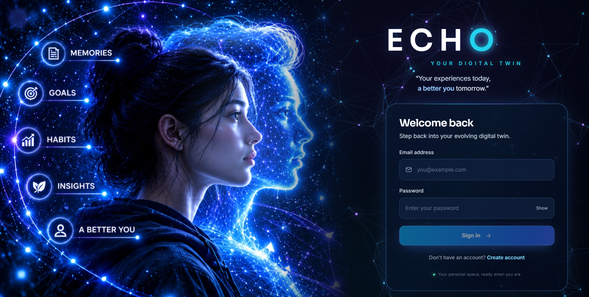

# ECHO — AI-Powered Digital Twin Platform

<p align="center">

**An AI-powered Digital Twin that learns from your experiences, understands behavioral patterns, and generates personalized insights.**

A Coordinator-based Multi-Agent AI System built with React, FastAPI, PostgreSQL and Mistral.

</p>

---

## 🎬 Project Demo

<!-- Replace the placeholder below with your uploaded demo video link -->

**Watch ECHO in action:** [](https://drive.google.com/file/d/1ndRU5sZ4tOQC4crTxOIif5IUxlAMEkHW/view?usp=sharing)


---

## 📌 Overview

ECHO is an AI-powered Digital Twin platform designed to maintain a structured understanding of an individual's experiences, current state, goals and behavioral patterns.

The idea behind ECHO is to create a digital representation of an individual — not an exact copy, but an evolving system that understands how different aspects of life are interconnected.

For example, sleep patterns can influence energy levels, energy can affect mood, and mood can influence learning and productivity.

ECHO captures these experiences as memories, analyzes them using Large Language Models, updates a graph-based Digital Twin and generates personalized insights, reflections and actionable plans.

**ECHO V2 introduces a Coordinator-based Multi-Agent Architecture**, allowing specialized agents to work together through shared context, dependency-aware execution and centralized workflow monitoring.

## ✨ Key Features

### 🧠 Intelligent Memory Processing
- Captures users' daily experiences as memories.
- Uses Mistral through Ollama to analyze unstructured text.
- Extracts sentiment, emotion, confidence, severity and affected life domains.
- Converts raw experiences into structured information.

### 🔗 Graph-Based Digital Twin
- Represents life domains using a custom weighted directed graph (ALSG).
- Models relationships between sleep, energy, mood and learning.
- Propagates changes across connected domains using weighted influence.
- Maintains current state and historical snapshots.

### 🤖 Multi-Agent AI Architecture
- Centralized Coordinator for workflow orchestration.
- Specialized agents with clearly defined responsibilities.
- Shared AgentContext using the Blackboard pattern.
- Agent dependency validation and controlled execution.
- Centralized execution tracking and failure handling.

### 📊 Behavioral Trend Analysis
- Compares historical Digital Twin snapshots.
- Calculates changes across different life domains.
- Provides trend information to downstream decision-making components.

### 💡 Personalized Decision Generation
- Generates contextual insights based on memories, goals, trends and current state.
- Creates actionable planner tasks.
- Supports eligible goal updates.

### 🪞 AI-Powered Reflection
- Generates personalized reflections using historical experiences.
- Connects memories with changes in the user's state.
- Provides practical recommendations.

### 🔮 Future Simulation
- Allows users to explore hypothetical scenarios.
- Uses the current Digital Twin state and goals as context.
- Generates AI-powered future scenario predictions.

### 📈 Workflow Execution Monitoring
- Tracks individual agent execution.
- Records success, failure, duration and error information.
- Maintains workflow execution history.
- Provides APIs to inspect previous executions.

---

## 🏗️ System Architecture

ECHO follows a layered architecture with a centralized multi-agent orchestration mechanism.

### Architecture Overview

```text
                  USER
                   |
                   v
           REACT FRONTEND
                   |
                   v
             FASTAPI API
                   |
                   v
             MEMORY SERVICE
                   |
                   v
            MEMORY ANALYZER
                   |
                   v
            OLLAMA / MISTRAL
                   |
                   v
          STRUCTURED ANALYSIS
                   |
                   v
            MEMORY PERSISTENCE
                   |
                   v
          MEMORY PROCESSED EVENT
                   |
                   v
                EVENTBUS
                   |
                   v
          COORDINATOR HANDLER
                   |
                   v
              COORDINATOR
                   |
             AGENT REGISTRY
                   |
             AGENT CONTEXT
                   |
                   v
          ---------------------
          |                   |
          v                   |
       TWIN AGENT             |
          |                  |
          v                  |
     TREND AGENT              |
          |                  |
          v                  |
    DECISION AGENT            |
          |                  |
          v                  |
   REFLECTION AGENT           |
          |                  |
          ---------------------
                   |
                   v
          BUSINESS SERVICES
                   |
                   v
          SQLALCHEMY ORM
                   |
                   v
              POSTGRESQL
```

### Architecture Layers

| Layer | Responsibility |
|---|---|
| Presentation Layer | React-based user interface |
| API Layer | FastAPI endpoints and request handling |
| Memory Processing Layer | Memory analysis using Mistral |
| Event Layer | Event-based communication through EventBus |
| Orchestration Layer | Coordinator, AgentRegistry and AgentContext |
| Agent Layer | Specialized AI and analytical agents |
| Business Logic Layer | Digital Twin updates, trend analysis, decisions and reflections |
| Persistence Layer | SQLAlchemy repositories and PostgreSQL |

---

## 🔄 End-to-End Workflow

When a user submits a new memory, the following workflow is executed:

**1. Memory Submission**

The user enters an experience through the React frontend. The frontend sends the memory to the FastAPI backend.

**2. Memory Analysis**

MemoryService invokes MemoryAnalyzer, which constructs a structured prompt and sends it to Mistral through Ollama.

The LLM extracts relevant information such as affected domains, sentiment, emotion, confidence and severity.

**3. Event Publication**

The memory and its analysis are persisted. MemoryService publishes a `MemoryProcessedEvent` through the in-process synchronous EventBus.

**4. Coordinator Invocation**

CoordinatorHandler receives the event, loads the required AgentContext and invokes the Coordinator.

**5. Multi-Agent Execution**

The Coordinator executes the default memory workflow:

| Order | Agent | Responsibility |
|---|---|---|
| 01 | TwinAgent | Updates the graph-based Digital Twin and creates snapshots |
| 02 | TrendAgent | Analyzes historical snapshots and calculates trends |
| 03 | DecisionAgent | Generates insights, planner tasks and goal updates |
| 04 | ReflectionAgent | Generates personalized reflections |

The Coordinator refreshes the shared context after successful agent executions so downstream agents can access updated information.

**6. Persistence**

The business services and repositories persist the generated outputs and updated Digital Twin state in PostgreSQL.

**7. Execution Monitoring**

Workflow and individual agent execution details are stored and made available through execution-history APIs.

---

## 🤖 Multi-Agent Architecture

ECHO V2 uses a centrally orchestrated multi-agent architecture.

Instead of allowing agents to invoke one another directly, a central Coordinator manages the execution sequence and dependencies.

### Core Orchestration Components

| Component | Responsibility |
|---|---|
| BaseAgent | Defines the common agent execution interface |
| AgentRegistry | Registers and retrieves specialized agents |
| AgentContext | Maintains shared workflow state and agent results |
| AgentStep | Defines agent execution steps and dependencies |
| Coordinator | Validates and executes the workflow |
| AgentContextLoader | Loads and refreshes the shared context |
| ExecutionTrace | Tracks workflow and agent execution details |

### Agent Responsibilities

**1. TwinAgent**
- Receives structured memory analysis.
- Invokes TwinUpdateService.
- Updates the graph-based Digital Twin.
- Persists updated state and historical snapshots.

**2. TrendAgent**
- Retrieves historical snapshots.
- Compares the latest and oldest available snapshots.
- Calculates numerical changes across life domains.
- Makes calculated trends available through AgentContext.

**3. DecisionAgent**
- Uses DecisionEngine and contextual information.
- Generates personalized insights.
- Creates actionable planner tasks.
- Produces possible goal updates.
- Uses Mistral through Ollama.

**4. ReflectionAgent**
- Uses current state, memories, snapshots and trends.
- Consumes the previous decision result.
- Generates personalized reflections using Mistral.
- Persists the generated reflection.

### Agent Communication

Agents communicate through a shared `AgentContext`, following the Blackboard architectural pattern.

The Coordinator passes the shared context through the workflow. Agents read relevant information and store their outputs without requiring direct dependencies on other agents.

---

## 🧩 Event-Driven Architecture

ECHO uses an in-process synchronous EventBus.

When a memory is processed, MemoryService publishes a `MemoryProcessedEvent`.

The EventBus dispatches the event to registered subscribers, including:

- CoordinatorHandler — initiates the multi-agent workflow.
- DailyChapterHandler — handles daily chapter processing separately.

This separates memory processing from the components that react to processed memories.

**Note:** The current EventBus is synchronous and in-process. It is not implemented using Kafka or RabbitMQ.

---

## 🧠 Graph-Based Digital Twin — ALSG

ECHO represents the user's life state through a custom weighted directed graph called ALSG.

### Graph Components

- **Nodes:** Represent life domains such as Sleep, Energy, Mood and Learning.
- **Edges:** Represent directional relationships between domains.
- **Weights:** Determine the strength of influence between connected nodes.
- **Propagation:** Transfers changes through connected nodes using weighted influence and confidence.

The graph-based model enables ECHO to represent interconnected changes instead of treating every life domain as an independent metric.

Updated states are persisted in PostgreSQL, while historical snapshots support trend analysis.

---

## 📊 Workflow Execution Monitoring

ECHO V2 includes a workflow execution tracking mechanism.

It records:

- Workflow name and execution status.
- Overall execution duration.
- Individual agent execution status.
- Agent execution duration.
- Errors and failure information.
- Skipped and not-run agents.

Execution history is persisted using two primary models:

- `WorkflowRun`
- `AgentExecutionRecord`

The relationship between them is one-to-many: one workflow run can contain multiple agent execution records.

### Execution History APIs

| Endpoint | Description |
|---|---|
| `GET /execution-history/` | Retrieves workflow execution history |
| `GET /execution-history/{run_id}` | Retrieves details of an individual workflow run |

---

## 🔮 Future Simulation

ECHO includes a separate simulation workflow that allows users to explore hypothetical scenarios based on their current Digital Twin state and goals.

The simulation service builds contextual prompts and uses Mistral through Ollama to generate future scenario predictions.

**Note:** Simulation is implemented separately through its own API and service. It is not one of the four registered agents in the default Coordinator workflow.

---

## 🛠️ Technology Stack

| Category | Technologies |
|---|---|
| Frontend | React.js, Tailwind CSS |
| Backend | Python, FastAPI |
| AI / LLM | Ollama, Mistral |
| Database | PostgreSQL |
| ORM | SQLAlchemy |
| Database Migrations | Alembic |
| Authentication | JWT |
| Multi-Agent Architecture | Custom Coordinator, AgentRegistry, AgentContext |
| Event Communication | In-process synchronous EventBus |
| Graph Representation | Custom ALSG |
| Testing | Pytest |
| API Documentation | Swagger UI, OpenAPI |

---

## 📂 Project Structure

```text
ECHO/
│
├── backend/
│   ├── app/
│   │   ├── agents/
│   │   │   ├── base.py
│   │   │   ├── context.py
│   │   │   ├── registry.py
│   │   │   ├── coordinator.py
│   │   │   ├── workflow.py
│   │   │   ├── workflows.py
│   │   │   ├── twin_agent.py
│   │   │   ├── trend_agent.py
│   │   │   ├── decision_agent.py
│   │   │   └── reflection_agent.py
│   │   │
│   │   ├── ai/
│   │   │   ├── prompt_builder.py
│   │   │   ├── reflection_prompt_builder.py
│   │   │   ├── simulation_prompt.py
│   │   │   ├── ollama_client.py
│   │   │   └── response_parser.py
│   │   │
│   │   ├── events/
│   │   │   ├── event_bus.py
│   │   │   ├── events.py
│   │   │   └── coordinator_handler.py
│   │   │
│   │   ├── graph/
│   │   │   ├── alsg.py
│   │   │   ├── node.py
│   │   │   ├── edge.py
│   │   │   ├── graph_builder.py
│   │   │   └── graph_persistence.py
│   │   │
│   │   ├── services/
│   │   ├── repositories/
│   │   ├── models/
│   │   ├── schemas/
│   │   ├── api/
│   │   └── main.py
│   │
│   ├── alembic/
│   ├── tests/
│   └── requirements.txt
│
├── frontend/
│   ├── src/
│   └── ...
│
└── README.md
```

---

## 🚀 Getting Started

### Prerequisites

Make sure you have the following installed:

- Python 3.10+
- Node.js and npm
- PostgreSQL
- Ollama
- Git

### 1. Clone the repository

```bash
git clone https://github.com/SanjanaManne70/ECHO--Digital-Twin-v1.git

cd ECHO--Digital-Twin-v1
```

### 2. Backend setup

```bash
cd backend

python -m venv venv
```

Activate the virtual environment:

**Windows:**

```bash
venv\Scripts\activate
```

**Linux / macOS:**

```bash
source venv/bin/activate
```

Install dependencies:

```bash
pip install -r requirements.txt
```

### 3. Configure environment variables

Create a `.env` file using the environment variable names defined in your backend configuration.

Configure your PostgreSQL connection and authentication settings.

Do not commit secrets, database passwords or JWT signing keys to GitHub.

### 4. Configure PostgreSQL

Create the ECHO database in PostgreSQL and configure the connection string in your environment.

Apply database migrations:

```bash
alembic upgrade head
```

### 5. Configure Ollama and Mistral

Install Ollama and download the model:

```bash
ollama pull mistral
```

Start the Ollama service and verify that the model is available:

```bash
ollama list
```

### 6. Run the backend

From the backend directory:

```bash
uvicorn app.main:app --reload
```

Backend API:

```text
http://localhost:8000
```

Interactive API documentation:

```text
http://localhost:8000/docs
```

### 7. Frontend setup

Open another terminal:

```bash
cd frontend

npm install
```

Start the frontend using the development script configured in `package.json`.

```bash
npm run dev
```

---

## 🧪 Testing

ECHO uses Pytest for backend unit and integration testing.

Run the tests from the backend directory:

```bash
pytest
```

The test suite covers components such as:

- Coordinator execution.
- Workflow dependency validation.
- Agent context loading.
- Event-driven integration.
- Decision output persistence.
- Multi-agent workflow execution.

---

## 🔐 Security and Reliability

- JWT-based authentication.
- Structured request validation.
- SQLAlchemy-based database interactions.
- Controlled persistence of decision outputs.
- Goal update confidence validation.
- Agent-level exception handling.
- Dependency-aware workflow execution.
- User-scoped execution history APIs.

---

## 🚧 Future Enhancements

Potential directions for extending ECHO include:

- Semantic memory retrieval using vector embeddings.
- Long-term memory indexing and retrieval.
- Background workflow execution using a message broker.
- Distributed agent execution.
- Retry and idempotency mechanisms.
- Advanced behavioral trend detection.
- Improved observability and performance monitoring.
- More sophisticated personalization and simulation models.

---

## 💡 Key Engineering Highlights

The major engineering contribution of ECHO V2 is the introduction of a structured multi-agent orchestration architecture.

Key design decisions include:

1. **Centralized Orchestration:** A Coordinator manages agent execution and dependencies.
2. **Blackboard Pattern:** Agents share information through a common AgentContext.
3. **Event-Driven Communication:** An in-process EventBus decouples memory processing from event subscribers.
4. **Graph-Based State Modeling:** ALSG models relationships and propagates changes across life domains.
5. **Execution Observability:** WorkflowRun and AgentExecutionRecord provide persistent execution tracking.
6. **Separation of Concerns:** Agents, business services, repositories and persistence responsibilities remain modular.

---

## 👩‍💻 Author

**Sanjana Manne**

B.Tech — Computer Science and Engineering

GitHub: [@SanjanaManne70](https://github.com/SanjanaManne70)

---

<p align="center">

**ECHO — A Digital Twin that evolves with your experiences.**

*From memories to understanding. From understanding to meaningful decisions.*

</p>
